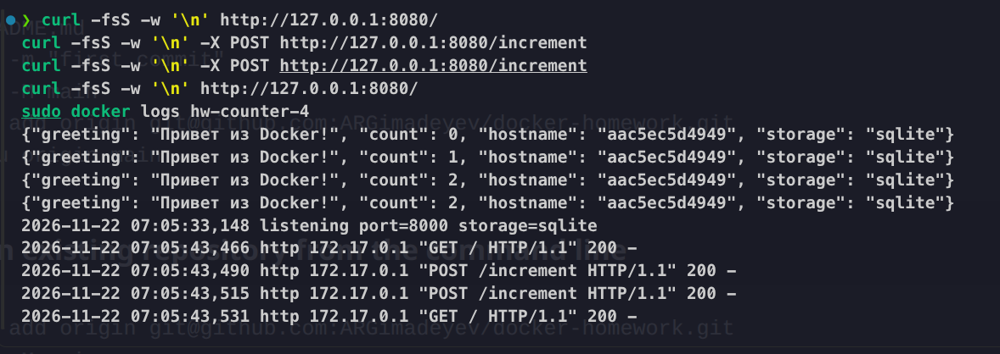
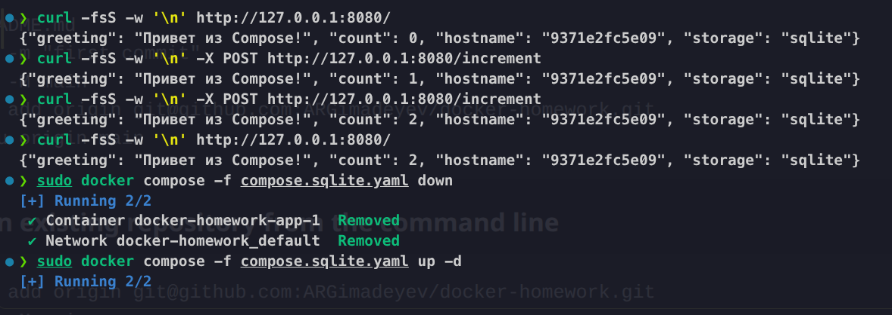
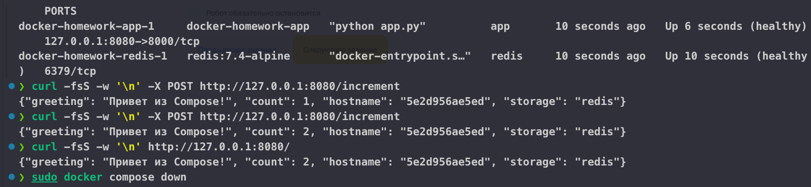
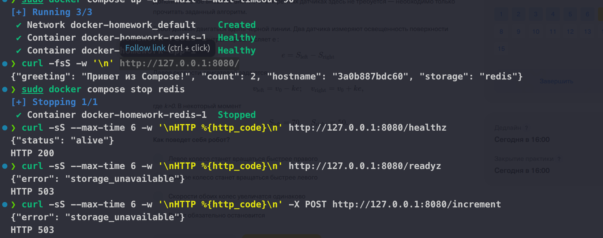
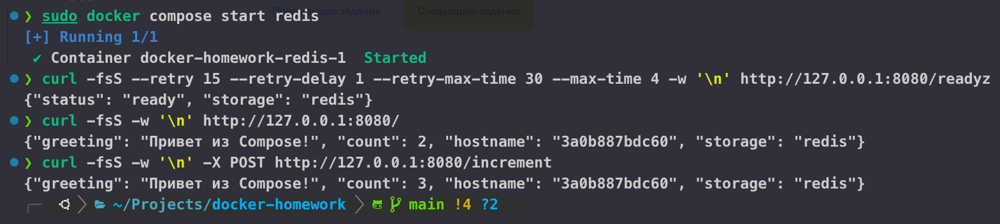

# Отчёт по Docker

## на 4 балла

приложение доступно на 8080. приветствие передано через GREETING.
Первый GET вернул 0, два POST увеличили счётчик до 2.
Повторный GET вернул 2.

## на 6 баллов

порт и приветствие задаются в `.env` через `APP_PORT` и `GREETING`.
файл SQLite `/data/counter.db` хранится в именованном томе `sqlite-data`.

### До удаления контейнера

### После пересоздания контейнера

после пересоздания `hostname` изменился, а `count` остался равным 2. Новый контейнер прочитал сохранённый счётчик из тома `sqlite-data`.

## на 8 баллов

два `POST /increment` вернули сначала 1, затем 2. перед
`sudo docker compose down` запрос `GET /` вернул `count: 2` и `storage: redis`.

после `sudo docker compose up -d --wait --wait-timeout 90` оба сервиса получили
статус `healthy`. имя в `hostname` изменилось с `5e2d956ae5ed`
на `3a0b887bdc60`, а `GET /` вернул 2. счётчик сохранился в томе Redis.

после `sudo docker compose stop redis` запрос `GET /healthz` вернул HTTP 200
и статус `alive`. `GET /readyz` и `POST /increment` вернули HTTP 503
с ошибкой `storage_unavailable`.

после `sudo docker compose start redis` запрос `GET /readyz` вернул статус
`ready`. приложение восстановило связь с Redis без ручного перезапуска.
`GET /` вернул 2, а следующий `POST /increment` увеличил счётчик до 3.

