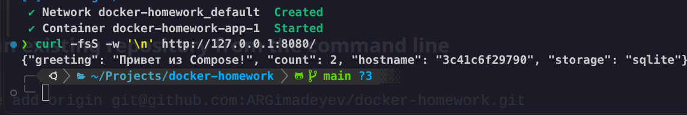

# Отчёт по Docker

## на 4 балла

приложение доступно на 8080. приветствие передано через GREETING.
Первый GET вернул 0, два POST увеличили счётчик до 2.
Повторный GET вернул 2.

## на 6 баллов

порт и приветствие задаются в `.env` через `APP_PORT` и `GREETING`.
файл SQLite `/data/counter.db` хранится в именованном томе `sqlite-data`.

### До удаления контейнера

### После пересоздания контейнера

после пересоздания `hostname` изменился, а `count` остался равным 2. Новый контейнер прочитал сохранённый счётчик из тома `sqlite-data`.